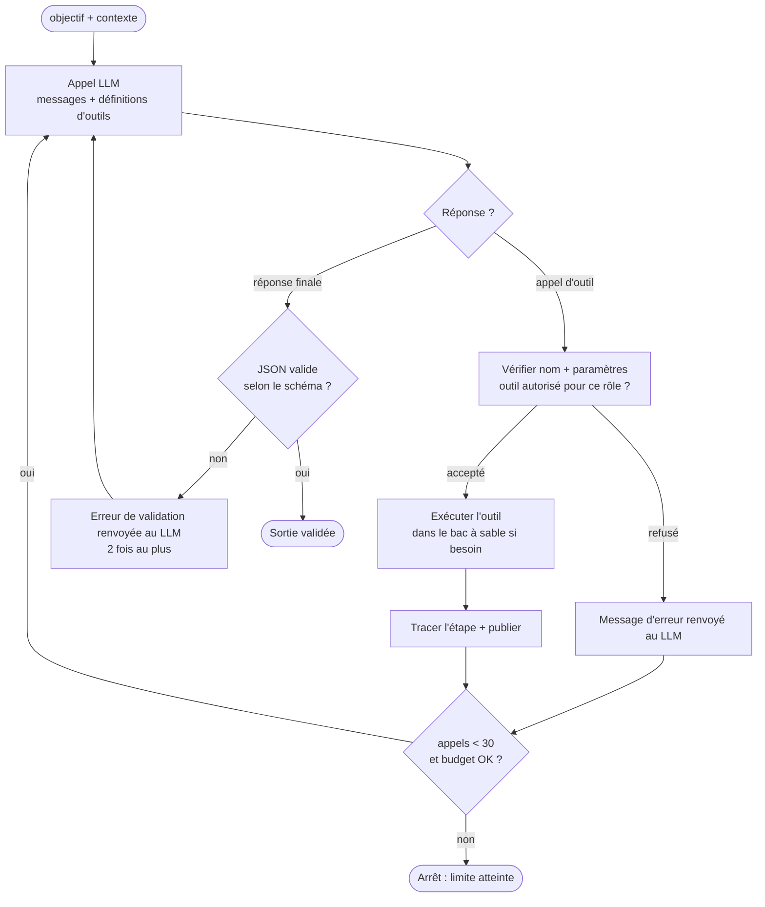

# Agents

Deux agents aux rôles opposés traitent chaque alerte, et les tests servent d'arbitre.
L'orchestrateur est un programme déterministe et non un troisième agent.

## 1. Boucle générique (`agents/boucle.py`, socle)

Les deux agents utilisent la même boucle d'appel d'outils et ne diffèrent que par le prompt, les outils autorisés et le schéma de sortie.



- Les définitions d'outils sont envoyées au format *function calling* compatible OpenAI (OpenRouter).
- La réponse finale est demandée en JSON et validée par un modèle Pydantic. Aucune sortie n'est utilisée sans validation.
- Les modèles utilisés raisonnent : leur réflexion arrive dans un champ distinct du contenu. Elle est
  lue, démasquée et publiée comme étape `raisonnement`, ce qui alimente le suivi en direct (voir D-13).
- Chaque appel LLM et chaque appel d'outil devient une ligne `etapes_agent` (traçabilité à 100 %).

## 2. Outils

Chaque outil est une fonction Python dont les paramètres sont validés avant l'exécution.
Les chemins sont résolus dans la racine du projet : tout chemin absolu ou contenant `..` qui sort du projet est refusé.

| Outil | Paramètres | Effet | Attaquant | Défenseur |
|---|---|---|:-:|:-:|
| `lire_fichier` | `chemin`, `debut?`, `fin?` | Contenu numéroté (400 lignes au plus) | ✓ | ✓ |
| `chercher_code` | `motif`, `glob?` | Lignes correspondantes (50 résultats au plus) | ✓ | ✓ |
| `ecrire_test` | `nom`, `contenu` | Écrit `tests/security/test_<nom>.py` uniquement | ✓ | ✗ |
| `appliquer_diff` | `diff` | Applique un diff unifié hors de `tests/`, refusé s'il est invalide | ✗ | ✓ |
| `executer_tests` | `cible?` | pytest dans le bac à sable, sortie résumée | ✓ | ✓ |

Interdits vérifiés par le code, pas seulement demandés dans le prompt :

- L'Attaquant ne modifie jamais le code de l'application (il n'a pas l'outil `appliquer_diff`).
- Le Défenseur n'écrit jamais dans `tests/`. Un diff qui touche `tests/` est refusé par l'outil et, en plus, par la validation.

## 3. Agent Attaquant (M3)

**Objectif** : prouver ou réfuter une alerte.

1. Lire le code signalé et remonter jusqu'au point d'entrée (route, paramètre).
2. Formuler une hypothèse et la résumer, ce résumé étant affiché dans le suivi.
3. Écrire un test pytest qui vérifie que la faille est exploitable via la route, à l'aide du client de test du framework.
4. Exécuter le test dans le bac à sable.
5. Conclure : `confirmee` si le test démontre la faille, `faux_positif` après 3 tentatives infructueuses.

Convention du test de preuve : il **passe** tant que la faille existe et **échoue** une fois la faille corrigée.
C'est ce qui permet à la validation de vérifier la correction.

Sortie (schéma `VerdictAttaquant`) :

```json
{
  "alerte_id": "B608-app.py-42",
  "verdict": "confirmee",
  "point_entree": "GET /users?name=",
  "test_fichier": "tests/security/test_sqli_users.py",
  "justification": "Deux à quatre phrases expliquant la conclusion."
}
```

`verdict` ∈ `confirmee`, `faux_positif`. Si le verdict est `confirmee`, le fichier de test doit exister et sa dernière exécution doit avoir réussi : l'orchestrateur le revérifie lui-même.

## 4. Agent Défenseur (M4)

**Objectif** : corriger une faille prouvée sans régression.

1. Lire la faille, le code concerné et le test de preuve (en lecture seule).
2. Produire un correctif **minimal** sous forme de diff unifié : requête paramétrée, validation d'entrée, liste blanche, variable d'environnement…
3. En cas d'échec de la validation, il reçoit le message d'erreur (test cassé, faille encore présente, alerte encore signalée) et propose une nouvelle version.
4. Après 3 échecs, la faille passe en revue humaine.

Sortie (schéma `PropositionCorrectif`) :

```json
{
  "alerte_id": "B608-app.py-42",
  "explication": "Remplacement de la concaténation par une requête paramétrée."
}
```

Le diff n'est pas recopié dans la réponse : l'orchestrateur le relit dans l'espace de travail (`git diff` depuis l'état de départ).
Le correctif enregistré est donc exactement celui qui a été appliqué et testé, et l'agent ne peut pas en déclarer un autre.

## 5. Contexte et mémoire

| Niveau | Contenu | Durée de vie |
|---|---|---|
| Contexte de conversation | Prompt système + message de tâche (alerte, extrait, exemple few-shot) + historique des appels d'outils et de leurs résultats | Une tentative |
| Mémoire de travail | Résumé ciblé de la tentative précédente : sortie du test de preuve (Attaquant) ou message d'échec de la validation (Défenseur) | Les tentatives d'une même faille |
| Mémoire persistante | PostgreSQL : verdicts, tests de preuve, correctifs, traces complètes | L'analyse, puis l'historique |

- Chaque tentative repart d'un contexte propre et reçoit seulement le résumé de l'échec précédent, pas tout l'historique : le contexte reste court et le coût prévisible.
- Aucune mémoire entre deux failles : chaque alerte commence avec un contexte neuf, ce qui évite qu'une faille influence le traitement de la suivante.
- Passage de relais : le Défenseur ne reçoit pas la conversation de l'Attaquant, mais le test de preuve enregistré, comme une donnée structurée.
- Récupération à la demande : l'agent ne reçoit pas tout le projet, il lit ce dont il a besoin via ses outils (400 lignes par lecture, 50 résultats par recherche, sorties tronquées à 4 000 caractères).
- Le masqueur est partagé par toute l'analyse : une même valeur reçoit toujours le même marqueur.

## 6. Limites (configurables par l'administrateur)

| Limite | Valeur par défaut | Effet quand elle est atteinte |
|---|---|---|
| Tentatives par agent et par faille | 3 | Attaquant : faux positif. Défenseur : revue humaine |
| Appels d'outils par faille | 30 | Faille en revue humaine |
| Budget de jetons par analyse | 400 000 | Analyse en pause, reprenable |
| Délai par appel LLM | 60 s | 3 nouvelles tentatives (1 s, 4 s, 16 s), puis pause |
| Délai par exécution dans le bac à sable | 120 s | Résultat « délai dépassé » renvoyé à l'agent |

## 7. Prompts

Rangés dans `prompts/` et versionnés dans Git. Leur évolution est présentée en soutenance.

```
prompts/
├── attaquant/systeme.md        # rôle, méthode, règles, format de sortie
├── defenseur/systeme.md
└── exemples/                   # few-shot, un dossier par famille
    ├── cwe-89/   attaque.md  correctif.md
    ├── cwe-78/   …
    ├── cwe-798/  …
    └── cwe-22/   …
```

Techniques (séance 2) :

- **Rôle** : « Tu es un expert en tests d'intrusion d'applications Python » (Attaquant) et « Tu es un développeur sécurité qui écrit des correctifs minimaux » (Défenseur).
- **Few-shot** : l'exemple de la famille de l'alerte est injecté dans le prompt.
- **Raisonnement étape par étape** : l'agent explique son hypothèse avant d'agir, et un résumé s'affiche dans le suivi.
- **Sortie structurée** : JSON obligatoire, validé par un schéma.

Chaque modification de prompt donne lieu à un commit `feat(prompts): …` qui explique la raison du changement (ex. « l'agent oubliait le client de test Flask »).
Le tableau de suivi des versions est tenu dans `prompts/CHANGELOG.md`.
