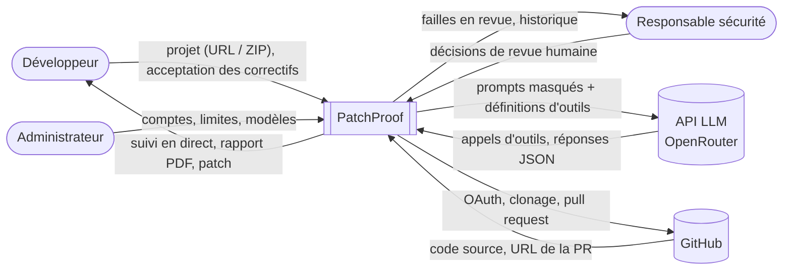
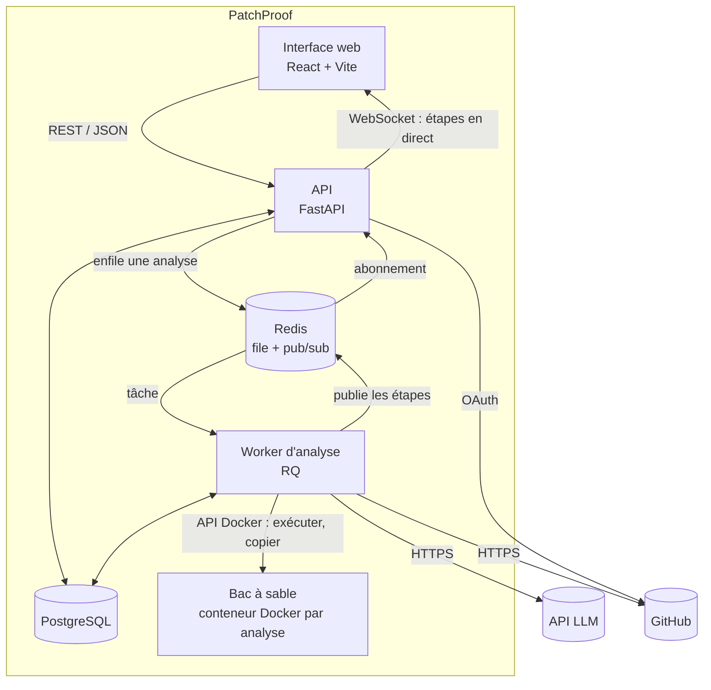
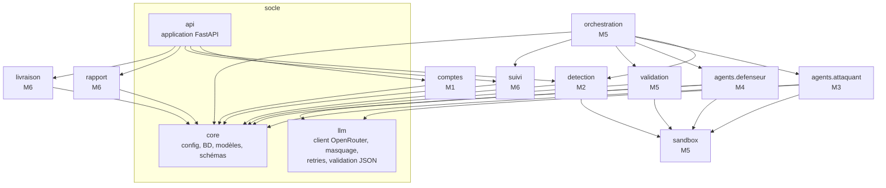
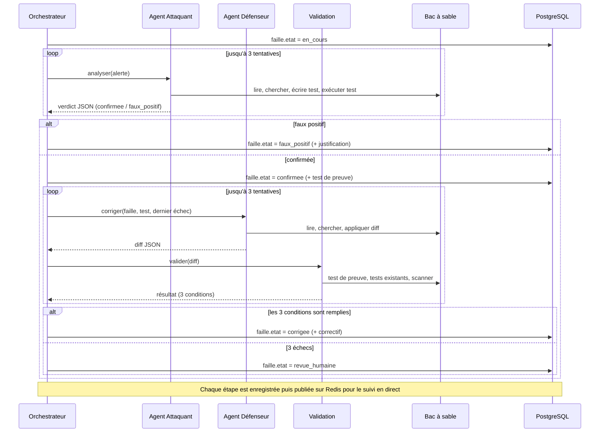
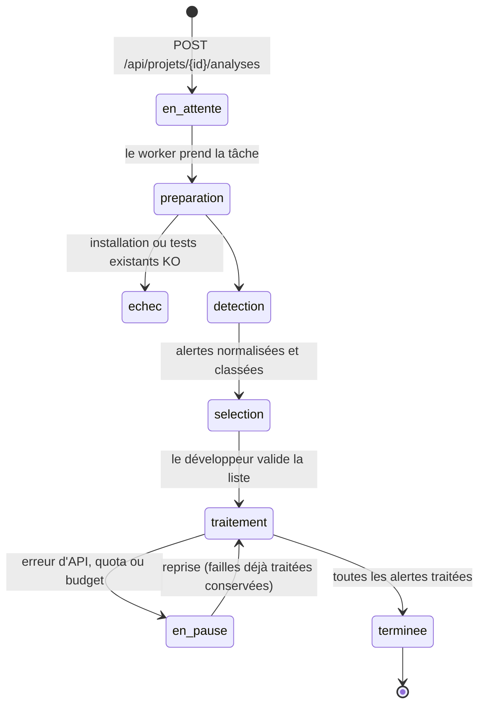
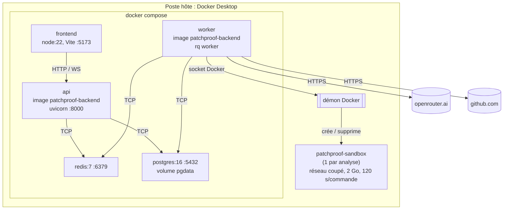

# Architecture

Structure inspirée d'arc42 : contexte, composants (boîte noire puis boîte blanche), exécution, déploiement.
Les diagrammes sont en Mermaid (rendus directement par GitHub).

## 1. Objectifs et contraintes

| Priorité | Objectif de qualité | Conséquence sur l'architecture |
|---|---|---|
| 1 | **Sécurité** : le code analysé ne s'exécute jamais hors du bac à sable | Conteneur Docker isolé par analyse, sans réseau à l'exécution |
| 2 | **Fiabilité** : un correctif accepté ne casse aucun test | Validation déterministe en 3 conditions, faite par du code et non par le LLM |
| 3 | **Traçabilité** : chaque décision d'agent est journalisée | Table `etapes_agent` remplie à chaque appel LLM et chaque appel d'outil |
| 4 | **Réactivité** : une analyse de plusieurs minutes ne bloque pas l'API | Worker séparé, file Redis, diffusion par WebSocket |

Contraintes : 7 semaines, 6 personnes, Python côté serveur, lancement en une commande (`docker compose up`).

## 2. Vue de contexte

PatchProof est ici vu comme une boîte noire, avec ses voisins et les données échangées.

Bandit, Semgrep et pytest ne sont pas des voisins : ils sont intégrés dans l'image du bac à sable.

## 3. Vue des composants

### 3.1 Niveau 1 (boîte blanche du système)

| Composant | Responsabilité | Interfaces fournies |
|---|---|---|
| Interface web | Soumettre un projet, suivre les agents, relire et accepter les correctifs, consulter le rapport | Pages web |
| API | Authentification, projets, création d'analyses, diffusion du suivi | REST `/api/*`, WebSocket `/ws/analyses/{id}` ([api.md](api.md)) |
| Redis | File des analyses en attente et canal des étapes | File RQ `analyses`, canal `analyse:{id}` |
| Worker | Orchestrateur déterministe et boucles des deux agents | Tâche `lancer_analyse(analyse_id)` |
| Bac à sable | Installer le projet, lancer les scanners et les tests | Commandes exécutées via l'API Docker |
| PostgreSQL | Projets, analyses, failles, tests, correctifs, traces | Schéma ([modele-donnees.md](modele-donnees.md)) |

### 3.2 Niveau 2 (paquet Python `patchproof`)

L'API et le worker partagent le même paquet Python et la même image Docker : seule la commande de lancement change.

Règle de dépendance : les modules dépendent du socle et des interfaces publiques des autres modules
(les fonctions listées dans [modules.md](modules.md)), jamais de leurs détails internes.
Seul `orchestration` enchaîne les modules entre eux.

## 4. Vue d'exécution

### 4.1 Traitement d'une alerte

Le détail de la boucle d'un agent (appels d'outils, limites) est dans [agents.md](agents.md).

### 4.2 Cycle de vie d'une analyse

`selection` correspond à l'exigence E-2.2 : le développeur peut exclure une alerte avant le passage des agents.

## 5. Vue de déploiement

- Le worker pilote le démon Docker de l'hôte (socket monté) pour créer les conteneurs du bac à sable.
- Les fichiers du projet sont copiés dans le conteneur (archive tar) et non montés depuis l'hôte, ce qui isole les analyses entre elles.
- Le conteneur n'a accès au réseau que pendant l'installation des dépendances. Il est détaché du réseau avant toute exécution du code du projet (voir [decisions.md](decisions.md), D-03).

## 6. Concepts transverses

| Concept | Où | Résumé |
|---|---|---|
| Garde-fous LLM | `llm/` | Masquage avant envoi, schéma JSON, délai de 60 s et 3 nouvelles tentatives ([securite.md](securite.md)) |
| Traces | `core/`, `suivi/` | Chaque étape d'agent est enregistrée en base puis publiée sur Redis |
| Configuration | `core/config.py` | Variables d'environnement uniquement (`.env`), aucune clé dans le code |
| Reprise | `orchestration/` | Les failles déjà dans un état final ne sont pas retraitées |
| Extensibilité | `detection/`, `prompts/exemples/` | Ajouter une famille = une règle de filtrage + un exemple few-shot, sans toucher aux agents |
