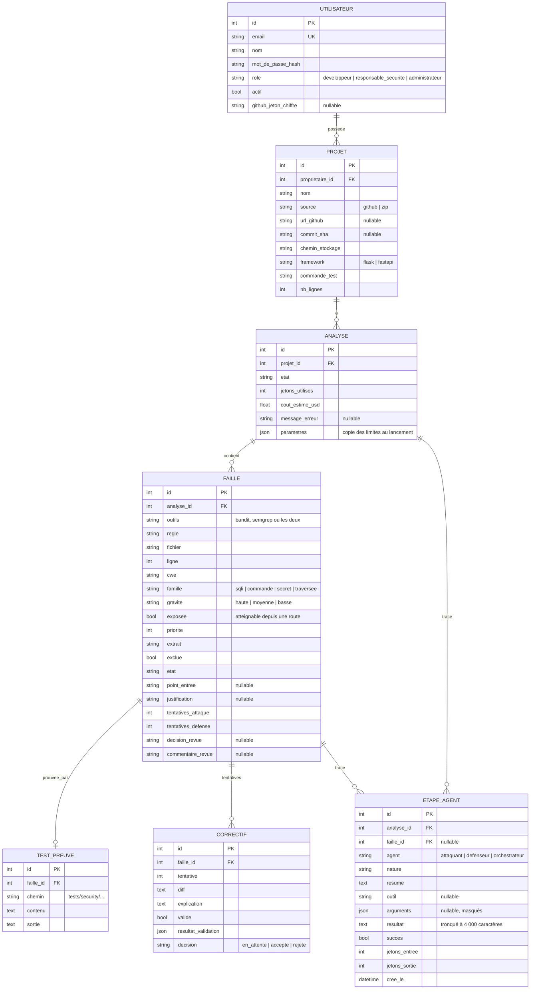
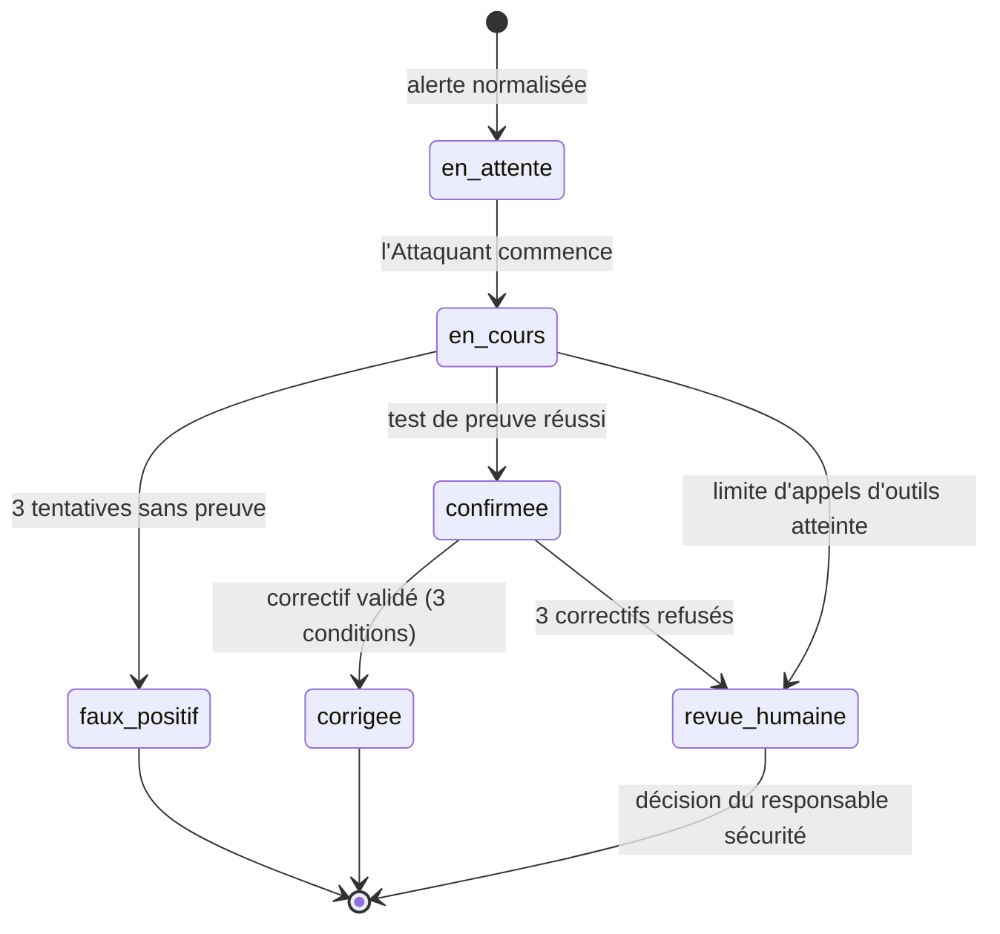

# Modèle de données

PostgreSQL 16 avec SQLAlchemy 2. Les modèles sont dans `backend/patchproof/core/modeles.py`.
En v1, les tables sont créées au démarrage (`create_all`). Pas de migrations tant que le schéma bouge.

## Diagramme

Les paramètres d'administration (`budget_jetons_analyse`, `max_tentatives_agent`, `max_appels_outils_faille`, modèles)
sont stockés dans une table `parametres` à une seule ligne, initialisée depuis `.env`.

## États d'une faille

Une faille marquée `exclue` par le développeur reste `en_attente` et n'est jamais traitée.

**Reprise** (E-5.3) : à la reprise d'une analyse, l'orchestrateur ne traite que les failles
`en_attente`, `en_cours` ou `confirmee`. Une faille `en_cours` repart de zéro, une faille `confirmee` repart au Défenseur
avec son test de preuve déjà enregistré.

## États d'une analyse

`en_attente` → `preparation` → `detection` → `selection` → `traitement` → `terminee`,
avec `en_pause` (erreur d'API, quota, budget) et `echec` (installation impossible, tests existants en échec).
Voir [architecture.md §4.2](architecture.md#42-cycle-de-vie-dune-analyse).
