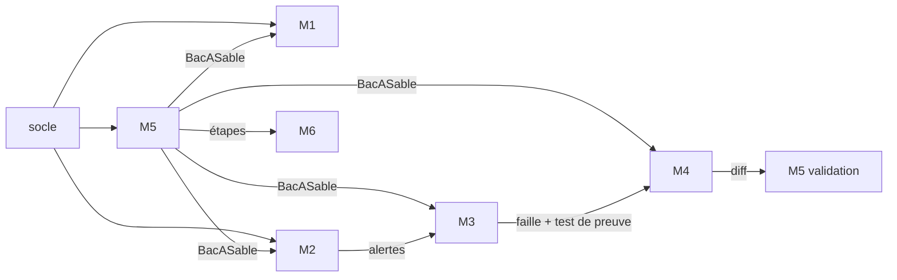

# Modules et responsables

Le cahier des charges définit 6 modules, et chaque membre en prend un.
Le **socle** (structure, configuration, base de données, client LLM, boucle d'agent générique) est livré dans le premier lot et sert à tous.

## Répartition

| Module | Responsable | Exigences | Dossiers |
|---|---|---|---|
| Socle | *(premier lot)* | Transverses | `backend/patchproof/{core,llm,api}/`, `backend/patchproof/agents/{boucle,outils}.py`, `backend/patchproof/worker.py`, `docker-compose.yml`, `frontend/src/` hors `pages/` |
| M1 – Comptes et projets | *à compléter* | E-1.1, E-1.2, administration | `backend/patchproof/comptes/`, `frontend/src/pages/comptes/`, `frontend/src/pages/projets/` |
| M2 – Détection | *à compléter* | E-2.1, E-2.2 | `backend/patchproof/detection/`, `sandbox/regles/`, `frontend/src/pages/alertes/` |
| M3 – Agent Attaquant | *à compléter* | E-3.1, E-3.2 | `backend/patchproof/agents/attaquant/`, `prompts/attaquant/`, `prompts/exemples/*/attaque.md` |
| M4 – Agent Défenseur | *à compléter* | E-4.1, E-4.2 | `backend/patchproof/agents/defenseur/`, `prompts/defenseur/`, `prompts/exemples/*/correctif.md` |
| M5 – Validation et orchestration | *à compléter* | E-5.1, E-5.2, E-5.3 | `backend/patchproof/{sandbox,validation,orchestration}/`, `sandbox/Dockerfile` |
| M6 – Suivi, rapport et livraison | *à compléter* | E-6.1, E-6.2, E-6.3, revue humaine | `backend/patchproof/{suivi,rapport,livraison}/`, `frontend/src/pages/{analyse,rapport,revue}/` |

L'application de démonstration (`demo-app/`) est un travail commun, à finir en semaine 2 (voir [demo.md](demo.md)).

Membres de l'équipe : Iheb Jlassi, Yosser Khaldi, Emna Homrani, Abdel Kader Kaddachi, Salma Louhichi,
Dhia Dine Bahi.
**Répartition à confirmer** : remplacer chaque *à compléter* par le responsable de son module, puis
reporter la même répartition dans [CONTRIBUTING.md](../CONTRIBUTING.md) §5 et sur la diapositive
« L'équipe » de la soutenance. En cas de changement de module, penser à mettre à jour les trois
endroits en même temps.

Chaque responsable écrit aussi les tests de son module dans `backend/tests/<module>/`.

## Intégration progressive

Les modules s'ajoutent un par un sans toucher au socle :

- **Backend** : un module qui expose des routes définit `router = APIRouter(...)` dans `backend/patchproof/<module>/routes.py`.
  `api/app.py` le charge automatiquement, et un module absent est ignoré (voir `GET /api/sante`).
- **Frontend** : un module déclare ses pages dans `frontend/src/pages/<module>/routes.tsx` :

```tsx
import type { RouteModule } from '../../modules'
import ListeProjets from './ListeProjets'

export const routes: RouteModule[] = [
  { chemin: '/projets', element: <ListeProjets />, menu: 'Projets', ordre: 10 },
]
```

Le menu, la protection par connexion (`publique`) et par rôle (`role`) sont gérés par le socle.
Composants communs : `components/Etats.tsx` (chargement, erreur, badges), `api/client.ts`, `api/useDonnees.ts`, `auth.tsx` (`useSession`).

## Interfaces publiques

Ce sont les seules fonctions qu'un module appelle chez un autre. Les types viennent de `patchproof.core.schemas`.
Changer une signature = pull request `socle/...` + mise à jour de ce document.

### Socle

```python
# core/config.py
parametres: Parametres                      # lu depuis les variables d'environnement

# core/db.py
def session() -> Session                     # session SQLAlchemy

# llm/client.py
class ClientLLM:
    def discuter(self, messages, outils, modele, schema_reponse=None) -> ReponseLLM
    # masquage, délai de 60 s, 3 nouvelles tentatives, validation JSON, comptage des jetons

# agents/boucle.py
def executer_agent(role: Role, objectif: str, outils: list[Outil],
                   schema_sortie: type[BaseModel], contexte: ContexteAgent) -> BaseModel
    # boucle générique : appel LLM -> appel d'outil -> résultat -> ... -> réponse finale validée

# agents/outils.py
OUTILS: dict[str, Outil]   # lire_fichier, chercher_code, ecrire_test, appliquer_diff, executer_tests
```

### M1 – Comptes et projets

```python
def importer_depuis_github(url: str, utilisateur: Utilisateur) -> Projet
def importer_depuis_zip(fichier: UploadFile, utilisateur: Utilisateur) -> Projet
def detecter_framework(chemin: Path) -> InfoProjet            # framework, commande de test, nb de lignes
def verifier_projet(bac: BacASable, info: InfoProjet) -> ResultatTests   # tests existants au vert ?
```

Routes : `/api/auth/*`, `/api/projets/*`, `/api/admin/*` (voir [api.md](api.md)).

### M2 – Détection

```python
def lancer_scanners(bac: BacASable) -> list[AlerteBrute]      # Bandit + Semgrep, sorties JSON
def normaliser(brutes: list[AlerteBrute]) -> list[Alerte]      # fichier, ligne, CWE, gravité, extrait
def fusionner(alertes: list[Alerte]) -> list[Alerte]           # doublons Bandit/Semgrep
def prioriser(alertes: list[Alerte], chemin: Path) -> list[Alerte]   # 4 familles, gravité, exposition
def alerte_toujours_presente(bac: BacASable, alerte: Alerte) -> bool # utilisée par la validation
```

### M3 – Agent Attaquant

```python
def analyser_alerte(alerte: Alerte, contexte: ContexteAgent) -> VerdictAttaquant
# au plus 3 tentatives, puis verdict faux_positif avec justification
```

### M4 – Agent Défenseur

```python
def proposer_correctif(faille: Faille, test_preuve: str, contexte: ContexteAgent,
                       echec_precedent: str | None) -> PropositionCorrectif
```

### M5 – Validation et orchestration

```python
class BacASable:
    @classmethod
    def creer(cls, analyse_id: int, chemin_projet: Path) -> "BacASable"
    def installer(self) -> ResultatCommande          # seule étape avec réseau
    def executer(self, commande: list[str], delai: int = 120) -> ResultatCommande
    def synchroniser(self) -> None                   # recopie l'état du projet dans le conteneur
    def detruire(self) -> None

def valider_correctif(bac: BacASable, faille: Faille, diff: str) -> ResultatValidation
# 1. test de preuve désormais en échec  2. tests existants au vert  3. alerte disparue

def lancer_analyse(analyse_id: int) -> None       # tâche RQ, reprenable
```

### M6 – Suivi, rapport et livraison

```python
def publier_etape(analyse_id: int, etape: EtapeAgent) -> None   # BD + Redis
def construire_rapport(analyse_id: int) -> Rapport
def exporter_pdf(rapport: Rapport) -> bytes                      # WeasyPrint
def generer_patch(analyse_id: int) -> str                        # correctifs acceptés + tests
def ouvrir_pull_request(analyse_id: int, jeton_github: str) -> str   # URL de la PR
```

## Dépendances entre modules (ordre de travail)



Le bac à sable (M5) est sur le chemin critique : sa première version (créer, exécuter, détruire) est attendue fin de semaine 2.
En attendant, M3 et M4 peuvent tester leurs agents avec un faux bac à sable (`tests/factices.py`) qui renvoie des résultats prédéfinis sans rien exécuter, ce qui respecte la règle « aucune exécution hors du bac à sable ».
